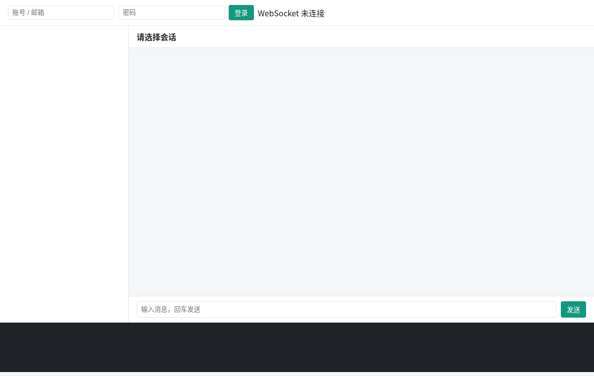
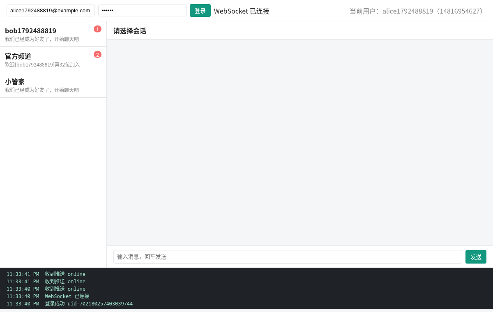
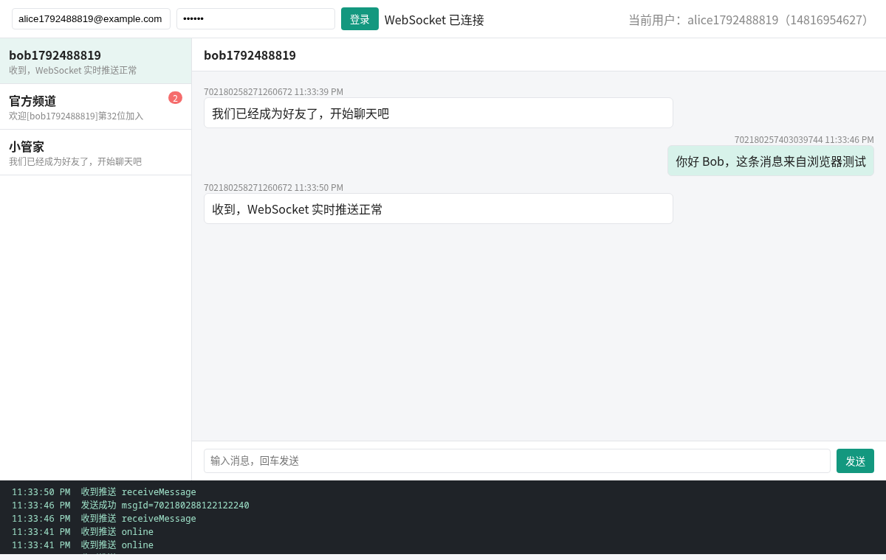
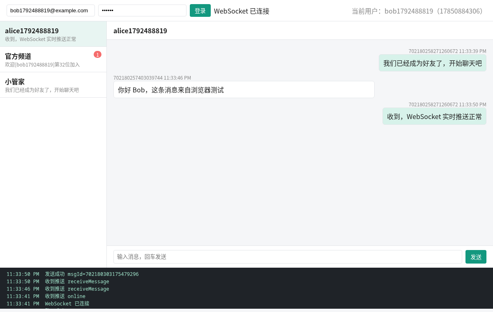

# 浏览器测试

服务自带一个 Web 测试控制台（`/console/index.html`），调用的接口和 WebSocket 协议与桌面客户端相同。浏览器测试用 deepseek-browser-use 驱动两个无头浏览器标签页，让两个新注册的用户在控制台里实时聊天，并在关键步骤截图。

## 运行

先启动 MySQL、Redis、本服务和 deepseek-browser-use（默认端口 10049），然后执行：

```shell
scripts/browser-test.sh
```

脚本做了这些事：

1. 通过接口注册 alice 和 bob 两个账号，alice 申请添加 bob 为好友，bob 同意，系统自动生成单聊会话。
2. 打开两个浏览器标签页，分别访问测试控制台。
3. alice、bob 分别登录，等待页面出现 “WebSocket 已连接”。
4. 两人打开同一个会话，alice 发送消息，bob 的页面通过 WebSocket 推送实时收到；bob 回复，alice 实时收到。
5. 截图保存到 `docs/assets`。

## 测试过程

### 1. 打开控制台



### 2. alice 登录后的会话列表

登录成功后建立 WebSocket 连接，左侧是会话列表，包括刚加好友产生的单聊会话、官方频道和系统助手，右上角显示当前用户。



### 3. alice 的聊天窗口

第一条是加好友后系统生成的打招呼消息，第二条是 alice 发出的消息，第三条是 bob 的回复，由 WebSocket 推送到达。底部日志里可以看到 `online`、`receiveMessage` 等推送事件。



### 4. bob 的聊天窗口

bob 这一侧消息顺序一致，自己发出的消息在右侧。会话列表里的最新消息摘要已经更新，未读数在读取后清零。



## 结果

- 登录、会话列表、历史消息接口返回正常
- 双方 WebSocket 连接成功，并收到对方的上线通知
- 消息发送成功后，对方实时收到 `receiveMessage` 推送，不需要刷新页面
- 会话摘要和未读数随消息实时更新
